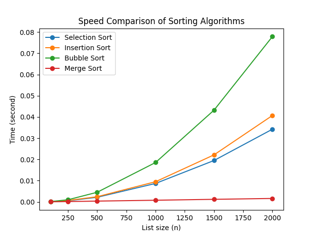

# Sorting Algorithms Benchmark

A small Python project that measures and compares the running time of four sorting algorithms on random lists of increasing size.

# Algorithms

| Algorithm | Time Complexity | Idea |
|---|---|---|
| Selection Sort | O(n²) | Repeatedly picks the smallest remaining element and puts it in place |
| Insertion Sort | O(n²) | Inserts each element into the already sorted left part |
| Bubble Sort | O(n²) | Swaps neighbouring elements until the largest "bubbles up" to the end |
| Merge Sort | O(n log n) | Splits the list in half recursively, then merges the sorted halves |

# How it works

1. For each list size (100, 250, 500, 1000, 1500, 2000), a random list is generated.
2. Every algorithm sorts a copy of the same list, so the comparison is fair.
3. Each measurement is repeated 3 times and averaged (`time.perf_counter()` is used for timing).
4. Results are printed as a table and saved as a chart.

# Results



Example output for n = 2000 (times vary by computer):

| Algorithm | Time (s) |
|---|---|
| Merge Sort | ~0.003 |
| Selection Sort | ~0.064 |
| Insertion Sort | ~0.064 |
| Bubble Sort | ~0.165 |

- Merge Sort is by far the fastest, and the gap grows as the list gets larger.
- Bubble Sort is the slowest because it performs many more swaps than the other O(n²) algorithms.
- Selection and Insertion Sort perform almost the same on random data.

# Getting started

Requirements: Python 3 and matplotlib.

```bash
pip install -r requirements.txt
python sorting-benchmark.py
```
The script prints a table of average times and saves the chart as `sort_graph.png`.

# What I learned

- How common sorting algorithms work and why their complexity differs
- Measuring code performance fairly (copying input, repeating and averaging measurements)
- Visualizing results with matplotlib
